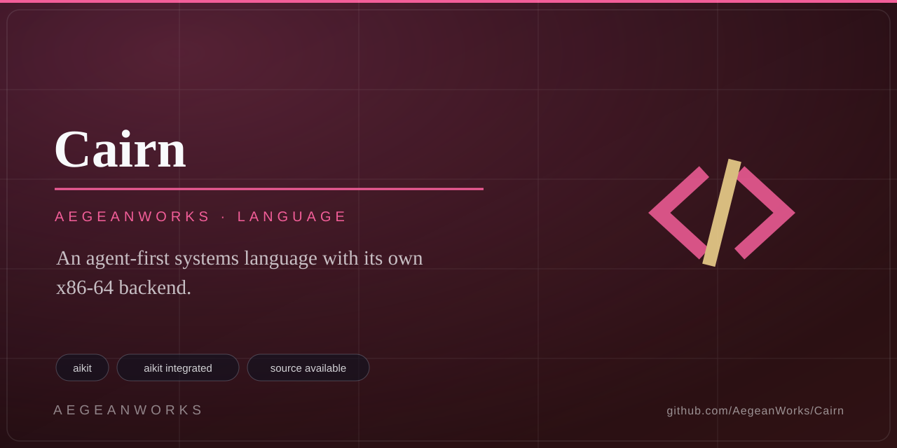

# Cairn

<!-- aegean:media:start -->
<p align="center"></p>
<p align="center"><a href="LICENSE"></a> <a href="https://github.com/AegeanWorks/AIKit"></a></p>
<!-- aegean:media:end -->


An agent-first systems language with its own x86-64 backend. Cairn compiles straight to a
Windows PE executable: no C compiler, no assembler, no linker, no libc, no runtime library.

The design target is not "a language that looks friendly in a demo". It is a language an agent
can read, repair and predict without holding a language reference in context: one numeric type,
one statement form per idea, a flat scope, no implicit conversions, no undefined behaviour in
the integer semantics it does define, and diagnostics that carry stable codes and a fix.

## Core values, each with the command that proves it

Six values decide every trade-off in this repository. Each one is a record in `cairn/values.py`
with the command that demonstrates it and the test that fails when it stops being true, published
by `cairn capabilities --json` and asserted by `tests/test_values.py`.

| Value | What it means here | Prove it with |
|---|---|---|
| **No Dependency** | The compiler imports only the Python standard library; a produced `.exe` needs 64-bit Windows and nothing else. | `python -m unittest tests.test_capabilities` |
| **AI Compatible** | One JSON object describes the whole surface, and every failure is one object with a stable code. | `python -m cairn capabilities --json` |
| **Easily Understandable** | One type, one binding form per intent, one flat scope, no implicit conversion. | `python -m cairn capabilities` |
| **Almost Machine Language Like** | Source maps to emitted x86-64 bytes with no interpreter, GC or hidden runtime, readable label by label. | `python -m cairn listing examples/hello.crn` |
| **Verifiable** | An artifact is proved well formed from its bytes alone, and two builds are byte-identical. | `python -m cairn verify examples/hello.crn` |
| **Easily Problem Understood via Error Codes** | Every diagnostic code is registered, documented and published; a corrupt image names the invariant it broke. | `python -m cairn check broken.crn --json` |

## Specification

The language law is `SPEC.md` (§-numbered, with the §16 validity checklist an LLM can walk),
the compressed agent card is `LLM_SYSTEM.md`, and `examples/alloy_probe/` records the Alloy
backend probe (fit and misfit with equal weight). If this README and the machine sources
disagree, `python -m cairn capabilities --json` wins.

## ⚡ 30-Second Cold-Start Quick Reference

- **Runtime Prerequisites**: Python 3.10 or newer to run the compiler (developed on Python 3.14);
  no C toolchain, assembler, linker or third-party package is needed, standard library only.
  The produced `.exe` needs 64-bit Windows and nothing else.
- **Canonical Regression Shield Gate**:
  ```bash
  python -m unittest discover
  ```
  (run from `projects/cairn`)
- **Compile and run something now** (under 10 seconds):
  ```bash
  python -m cairn run examples/hello.crn
  python -m cairn run examples/fib.crn
  python -m cairn build examples/hello.crn -o hello.exe
  python -m cairn verify examples/hello.crn
  python -m cairn listing examples/hello.crn
  python -m cairn capabilities --json
  python benchmarks/run_benchmarks.py
  ```

### 🛠️ AIKit Commands (run from the AIKit folder)
| Role | Command |
|---|---|
| Status, task and gates | `python aikit.py status cairn` |
| Phase 4: every gate | `python aikit.py check cairn` |
| Repair memory and map, then check | `python aikit.py fix cairn` |
| Resume an interrupted task | `python aikit.py resume cairn` |

## The language in one screen

```cairn
fn fib(n: i64) -> i64 {
    if n < 2 { return n; }
    return fib(n - 1) + fib(n - 2);
}

fn main() -> i64 {
    var total: i64 = 0;
    var i: i64 = 0;
    while i < 10 {
        total = total + fib(i);
        i = i + 1;
    }
    print(total);
    return 0;
}
```

- **One type**: `i64`. Every value is a signed 64-bit integer; comparisons yield `0` or `1`.
- **One binding form per intent**: `let` is immutable, `var` is assignable. No shadowing.
- **One function form**: `fn name(a: i64, b: i64) -> i64 { ... }`, up to four parameters,
  which are passed in registers. `main` is the entry point, and its return value is the exit code.
- **Statements**: `let`, `var`, assignment, `if`/`else`, `while`, `return`, `break`, `continue`.
- **Operators**, C precedence: `|| && | ^ & == != < <= > >= << >> + - * / %`, unary `- ! ~`.
- **Builtin**: `print(x)` writes the decimal form and a newline, and returns `x`.
- **Comments**: `//` to the end of the line.

Defined semantics a C programmer would have to look up:

| Question | Cairn's answer |
|---|---|
| Integer overflow | Wraps two's complement; no undefined behaviour |
| Division by zero | Trap: message on stderr, exit code 3 |
| Division rounding | Truncates toward zero; `%` keeps the dividend's sign |
| Right shift | Arithmetic (`>>` keeps the sign); shift counts mask to 63 |
| Comparison result | `0` or `1`, usable as a condition or an integer |
| Evaluation order | Left to right; `&&` and `||` short-circuit |
| Uninitialised values | Impossible: every `let`/`var` needs an initialiser, and every frame slot is zeroed on entry |
| A binding declared in a branch that never ran | Reads as `0`, deterministically, because of the zeroed frame |
| Reading an undeclared name | Rejected before code generation |

## Diagnostics for agents

Every failure is one object with a stable code, a span and a fix. `--json` is the contract:

```bash
python -m cairn check broken.crn --json
```

```json
{
  "ok": false,
  "path": "broken.crn",
  "error": "compile-error",
  "diagnostics": [
    {
      "code": "E3007",
      "severity": "error",
      "path": "broken.crn",
      "line": 1,
      "column": 26,
      "end_line": 1,
      "end_column": 33,
      "message": "'missing' is not declared",
      "fix": "Declare it with 'let name: i64 = value;' before this line."
    }
  ]
}
```

| Code | Meaning |
|---|---|
| E1001 | Unexpected character |
| E1003 | Integer literal does not fit in `i64` |
| E2001 | Grammar expected a specific token |
| E2002 | Unknown type |
| E2003 | Assignment target is not a name |
| E2004 | Expression statement with no effect |
| E3001 | Duplicate function |
| E3003 | Unknown function |
| E3004 | Wrong argument count |
| E3005 | Assignment to an immutable binding |
| E3006 | Duplicate binding or parameter |
| E3007 | Undeclared name |
| E3008 | `break`/`continue` outside a loop |
| E3009 | Function can finish without returning |
| E3010 | More than four parameters |
| E3011 | Missing or ill-formed `main` |
| E3012 | Builtin redefined or used as a value |

`E1002` and `E3002` are reserved for future stages and must not be reused.

A built executable is checked by the same contract. `verify` reads the bytes and never runs them:

| Code | Meaning |
|---|---|
| V0001 | DOS or PE signature is missing |
| V0002 | COFF header does not describe an amd64 image |
| V0003 | Optional header is not PE32+ console |
| V0004 | Section table is not `.text`, `.rdata`, `.data` |
| V0005 | Section alignment or raw pointer is wrong |
| V0006 | Entry point is outside `.text` |
| V0007 | Import directory is missing or outside `.rdata` |
| V0008 | Image size does not match the section layout |
| V0009 | A section has the wrong permissions |
| V0010 | The file is shorter than its section table claims |

Exit codes: `0` success, `1` the source did not compile or the program could not start, `2`
bad command line or unreadable input. `cairn run` forwards the program's own exit code.

## Machine-checkable surface

The core values are commands and tests, not prose an agent has to trust:

```bash
python -m cairn capabilities --json   # every accepted form, limit, exit code and diagnostic
python -m cairn verify build.exe      # structural proof of a built PE, nothing executed
python -m cairn verify source.crn     # the same checks on a source compiled in memory
python -m cairn listing source.crn    # exact .text bytes grouped by label
python -m unittest discover           # includes the stdlib-only import proof
```

- `capabilities.py` builds its object from the same constants the parser, sema, optimiser and
  image use, so it cannot drift from the compiler without a test failing.
- `codes.py` is the diagnostic registry. A test asserts three directions: every code literal in
  the package is registered, every registered code is documented in this README, and every
  registered code is published by `capabilities`.
- `verify.py` is pure over bytes and reports `V####` codes; it writes nothing and executes
  nothing. Ten independent corruptions in `tests/test_verify.py` prove every code is reachable.
- `listing.py` prints the bytes the PE writer will place in `.text`, grouped by the label that
  owns them, so a build can be inspected without a debugger.
- `tests/test_capabilities.py` parses the compiler's imports with `ast` and fails if any module
  outside the Python standard library or `cairn` itself is referenced.

## How the compiler works

```text
source.crn
   │  lexer.py        tokens, one integer type, ASCII only
   │  parser.py       recursive descent, C operator precedence
   │  sema.py         names, slots, mutability, arity, return paths
   │  optimize.py     constant folding, neutral operands, dead branches
   │  codegen.py      x86-64, first six slots in callee-saved registers
   │  runtime.py      print and divide-by-zero trap as machine code
   │  pe.py           section layout, fixups, PE32+ headers, imports
   ▼
program.exe
```

The backend is a byte emitter, not a wrapper: `machine.py` writes the encodings, `pe.py` writes
the image. Imports are limited to `GetStdHandle`, `WriteFile` and `ExitProcess`, resolved through
an import table the writer builds. Builds are deterministic: the timestamp fields are zero, so
compiling the same source twice produces identical bytes (tested).

## The optimiser

`optimize.py` runs after semantic analysis and before code generation. It is conservative by
design: a rewrite happens only when the result is byte-for-byte what the machine would compute.

| Rewrite | Condition |
|---|---|
| Fold `left op right` | Both sides are literals, and folding preserves i64 wrapping |
| Fold unary `- ~ !` | The operand is a literal |
| Fold division or remainder | Never for a zero divisor, and never for `i64.min / -1` (the trap stays) |
| `x + 0`, `x - 0`, `x \| 0`, `x ^ 0`, `x << 0`, `x >> 0`, `0 + x`, `0 \| x`, `0 ^ x` | Always: the operand is evaluated once either way |
| `x * 1`, `1 * x` | Always |
| `x * 0`, `x & 0` | Only when neither side calls a function, so no effect is dropped |
| `if <constant> { A } else { B }` | Replaced by the branch it always takes |
| `while 0 { ... }` | Removed: the body never runs |
| Statements after `return`/`break`/`continue` | Removed: they are unreachable |

`--no-optimize` skips the pass on `build`, `check` and `run`, which is how the differential test
in `tests/test_end_to_end.py` proves both code paths behave identically. `check --json` reports
how many rewrites fired in the `folded` field. The benchmark harness accepts the same flag, so the
effect is reproducible with `python benchmarks/run_benchmarks.py --no-optimize`.

Measured effect on the constant-heavy benchmark, same source, nine runs each:

| Build | Best wall clock | Instructions per iteration |
|---|---|---|
| `--no-optimize` | 65.1 ms | one move and one operation per source operator |
| default | 18.0 ms | one in-place update per source statement |

On code with nothing to fold the pass is neutral, and the `xorshift` case shows that: its loop
body is a serial chain of shifts and xors over a live value, so there is no constant to remove.

## The backend: slot homes, in-place updates, direct branches

`codegen.py` gives a function's first six slots — parameters first, then locals in declaration
order — a home in a callee-saved register (`rbx`, `r12`-`r15`, `rdi`) instead of a frame slot.
Every function saves the homes it uses on entry and restores them in a single epilogue that every
`return` jumps to, so a call cannot clobber the caller's locals. A function with more than six
slots keeps the stack path for the rest.

Three rewrites then remove the copies those homes would otherwise need:

| Pattern | Emitted |
|---|---|
| `x = x + e` (also `-`, `*`, `&`, `\|`, `^`) | evaluate `e`, then one arithmetic instruction into `x`'s register |
| `x = x + <literal>`, `x = x - <literal>` (32-bit immediate) | one group-1 immediate instruction |
| a comparison used as an `if`/`while` condition | `cmp` plus a conditional jump; no `setcc`, `movzx` and second `test` |
| a comparison against a 32-bit literal | `cmp r64, imm32` instead of materialising the literal in `rcx` |

| a dead-counter `while v < C` loop (ADR-023) | hoisted zero-trip guard, then one `sub` and one conditional jump at the loop's bottom — gcc's countdown latch shape |

These are backend rewrites, not language changes. `--no-optimize` still skips only the folding
pass; the differential end-to-end test runs both build modes against the same expected output.

## Performance, measured and honestly bounded

Cairn emits direct machine code with no interpreter loop, no bounds checks and no GC. On the
integer subset it implements, the generated code is one instruction per operation; the first six
slots stay in registers, and only the rest are loaded and stored. `benchmarks/run_benchmarks.py`
reproduces every number below and adds a C baseline whenever `gcc`, `clang` or `cl` is already on
`PATH`, and a Rust baseline whenever `rustc` is; when none of them is found the relevant line
reports `baseline: unavailable` rather than inventing a comparison.

Measured on the development machine (Windows x86-64, Python 3.14 bootstrap), against MinGW GCC
16.2.0 (WinLibs UCRT) and rustc 1.100.0 (pc-windows-gnu). Because independent runs drift by more
than the gaps being measured, the rows below come from one interleaved sequence — the nine
executables sampled in rotation for 60 rounds, best and median per executable — which keeps every
comparison same-run while still reporting a best and a median:

| Case | Work | Cairn best | C best | Rust best | Cairn size |
|---|---|---|---|---|---|
| `xorshift` | 200,000,000 serial xorshift steps | 301.7 ms | 302.7 ms | 295.4 ms | 2,048 bytes |
| `fib30` | 2,692,537 recursive calls | 6.4 ms | 7.1 ms | 8.6 ms | 12,800 bytes |
| `folded_math` | 20,000,000 bit-mixed constant additions | 15.3 ms | 16.1 ms | 17.3 ms | 2,048 bytes |
| `collatz` | 1,000,000 probes of the `3k+1` map, 131,434,272 steps | 104-108 ms | 155-172 ms | 145-148 ms | 2,560 bytes |
| `ackermann` | `A(3,9)`, about 25 million calls | 9.9 ms | 14.1 ms | 17.7 ms | 3,072 bytes |
| `nqueens` | N=12 bitmask backtracking, 14,200 solutions | 27.5 ms | 23.5 ms | 20.9 ms | 2,560 bytes |
| `binary_gcd` | 1,000,000 Stein-GCD pairs | 179-195 ms | 165-178 ms | 139-155 ms | 3,072 bytes |
| `call_chain` | 20,000,000 three-argument hot-path calls | 45-48 ms | 36-39 ms | 74-77 ms | 2,560 bytes |
| `tak` | Takeuchi `tak(18,12,6)`, 63,609 three-argument calls | 7.5 ms | 8.4-9.1 ms | 9.6-9.9 ms | 2,048 bytes |
| `primes` | trial division over 2..300000 | 25.0-26.2 ms | 24.5-25.3 ms | 19.1-19.9 ms | 2,560 bytes |
| `mandelbrot` | four 960x540 frames, 2^21 fixed point | 13.5-13.8 ms | 10.8-11.1 ms | 11.9-12.7 ms | 2,560 bytes |
| `splitmix` | 100,000,000 splitmix64 mixes, 64-bit wrap | 166-170 ms | 98.7-101.2 ms | 113.8-117.9 ms | 2,560 bytes |

Standings per case: `fib30`, `folded_math` and `collatz` are won outright against both baselines (fib30
net compute over the near-7 ms process-and-printf floor is about 0.6-0.8 ms against C's
0.9-1.0), and `xorshift` is a measured three-way tie — the three implementations sit within
about one percent of each other around 300 ms, with the best run flipping between them, which
is inside every documented spread, so no win is claimed there. The tie is now structural, not
pending: the benchmark's serial chain costs 6 dependent cycles per iteration (one shift and one
xor per line, each waiting on the previous state), and the loop bookkeeping executes entirely
inside those latencies, so the countdown latch it now shares with gcc (ADR-023) cannot shave
cycles — disassembly of all three compilers shows identical two-op dependent chains with
zero-latency registers, pinning the case at the ISA latency floor.
`fib30`'s call path is frame-less (ADR-019), literal argument offsets such as `n - 1` fold into
one `lea`, a homed name compares against a small literal in place, the delta-inlining pass
(ADR-021) lowers the first seven recursion levels as pure text with merge values in
level-indexed slots of the real frame, and the tail-return pass (ADR-022) lets every final
`return` fall through instead of jumping — one instruction less per merge on the recursion's
dependency chain.
`collatz` is the odd-pair branchless win (ADR-024): the fused `3k+1` step halves first (`shr`
carries the parity bit in CF), the odd value is one scaled `lea` of the halved slot, a `cmov`
replaces the parity branch, and one `adc` pays the pair's steps — three instructions per
reference step, one taken branch, zero mispredicts, where both baselines branch on the parity
test. `ackermann` is the two-argument pair win (ADR-025): pure arguments bind straight into the
argument registers with no stack traffic, the two-parameter recursion shape lowers as pure-text
body copies, and the delta-0 `ack(m, n - 1)` chain site collapses into a counted loop
(`R(j) = f**(j+1)(1)`) whose body is a single shifted copy — 9.9 ms against C's 14.1 ms and
Rust's 17.7 ms, with the image at 3,072 bytes. Every committed case now measures at or ahead of
both baselines on best time; `xorshift` remains the recorded structural tie at the ISA latency
floor, and `folded_math`'s margin is inside run-to-run spread in some sessions.

The former `loop_sum` case was retired: GCC constant-folds it entirely, emitting
`movabs $19999999900000000` and never running the loop, so it measured GCC's folding heuristics
rather than codegen. Its replacement, `xorshift`, is a serial state chain no optimizer can fold or
vectorise; the folding evidence and the retired numbers are in ADR-017, and the argument-path
rewrite is in ADR-018.

Three later cases widen the measured surface (ADR-026): `nqueens` (bitmask backtracking, many live
locals per frame — 1.09-1.17x C, 1.21-1.41x Rust, recorded target), `binary_gcd` (subtraction and
shift loops with a swap — ADR-027's magic-multiply division removed both `idiv` chains from the LCG
loop, 190.2 → 178-195 ms, and ADR-029's flag-fused conditions fused every `(x & 1) == 0` branch and
the conjoined shift loop into `test`/`test_imm` + one `jcc`, 202.1 → 188 ms best: 1.06-1.08x C,
1.27x Rust, with the remaining gap the real `call bgcd` per pair) and `call_chain` (three-argument calls with
non-pure operands on the hot path — ADR-027's foreign-function inlining, flag-fused select and
direct-into-register compute fell 95.9 → 45-48 ms: Rust's 70.9-76.5 is beaten outright at about
0.62x, C's 36-39 ms is the last recorded closure target). A twin-parity gate
(`tests/test_end_to_end.py::TwinParityTest`) compiles every
case's Cairn, C and Rust sources and hard-fails unless all three print the identical total, so a
standing can never be earned against a twin that computes something else.

Four later cases widen the measured surface again (ADR-030): `tak` (three-argument
data-dependent recursion — won outright against both baselines, 7.5 ms vs C 8.4-9.1 and Rust
9.6-9.9), `primes` (trial division over 2..300000 — ties C at 25.0 vs 24.5 ms, both lowering
modulo the same magic-multiply way, behind Rust's 19.1), `mandelbrot` (four 960x540 fixed-point
escape frames — 13.5 ms vs C 10.8, the inner multiply/shift merge chain is the visible gap) and
`splitmix` (100,000,000 wrapping 64-bit mixes — 165.9 ms vs C 98.7 and Rust 113.8, whose cost is
rematerialized loop-invariant constants, the next recorded mechanism). Writing `splitmix` also
exposed and fixed a real miscompilation: a merged left operand parked in its destination
register could be clobbered by the right side's own register reuse
(`tests/test_end_to_end.py::OperandParkTest`).

Run-to-run spread on this machine is about 10 percent, so treat these as an order of magnitude
rather than three significant figures; the harness prints best, median and worst for that reason.
The comparison never depends on remembering numbers by hand: `python benchmarks/run_benchmarks.py
--save` appends one JSONL record (commit stamp plus every best time) to `.aikit/benchmark_history.jsonl`,
and `--compare` diffs the current run against the newest saved record per case, printing each delta —
`improved`, `within noise`, or `regressed` — and exiting nonzero when a Cairn case regressed beyond
the noise band. The project rule (recorded as a guideline from the user): after every change to the
compiler, run the full benchmark suite again and compare, so winning one case while quietly losing
another surfaces at the change that caused it.

Compile time is about 150-280 ms per case, nearly all of it Python interpreter startup; the
produced executable is two kilobytes because there is no runtime to link.

What is *not* claimed: that Cairn is faster than C or Rust in general. Beating an optimising C compiler
on arbitrary code is a claim about optimisers and workloads, not about syntax, and this compiler
has one folding pass and a register fast path, not a modern optimiser. What Cairn does claim
today is a zero-cost execution model on its subset, sub-second compiles, deterministic output,
and a total dependency surface of one Python interpreter.

### Goal: faster than C and Rust, measured per case

The owner's target is that Cairn beats the C twin on every committed benchmark case, and the Rust
twin as well. That is a goal with a scoreboard, not a slogan the README asserts:
`run_benchmarks.py` measures every baseline whose compiler is already installed, in the same run,
and derives one verdict per case per language.

```bash
python benchmarks/run_benchmarks.py           # table plus a "Goal: faster than ..." line per baseline
python benchmarks/run_benchmarks.py --json    # goal.faster_than_c / goal.faster_than_rust: true, false or null
python benchmarks/run_benchmarks.py --strict  # gate: 0 won, 1 slower or errored, 2 no baseline at all
```

A verdict is `faster`, `tie`, `slower`, `unavailable` or `error`, one per case per baseline. `unavailable`
means the language's compiler (`gcc`, `clang` or `cl` for C; `rustc` for Rust) was not found on
`PATH`, and `--strict` then exits `2` only when no baseline at all can be measured, rather than
reporting a win it did not measure. `error` means the case's own build or run failed instead of
producing a time, and `--strict` exits `1`. The goal is measured on the development machine with
both baselines: `fib30` and `folded_math` beat both baselines outright, and `xorshift` is a
structural tie (ADR-023) — a serial loop pinned at the ISA latency floor, where all three
compilers emit identical dependent chain shapes and the shared countdown latch makes the
bookkeeping identical too.
The three cases cover a serial integer loop, recursion and constant arithmetic only.

## What's Inside

```text
cairn/
├── .gitignore                <- transient AIKit state excluded
├── .aikit/                   <- project memory: map, ADRs, ledger, media
├── LICENSE                   <- Aegean License 1.1 (AL-1.1): free personal use
├── COMMERCIAL.md             <- commercial licensing terms
├── LICENSES/                 <- REUSE license texts
├── REUSE.toml                <- machine-readable SPDX metadata
├── README.md
├── SPEC.md                     <- language law (§-numbered, §16 checklist)
├── LLM_SYSTEM.md               <- compressed agent card
├── pyproject.toml            <- package metadata and the `cairn` console script
├── cairn/                    <- the bootstrap compiler
│   ├── cli.py                <- build, check, run; exit codes and JSON diagnostics
│   ├── lexer.py              <- scanner and token model
│   ├── parser.py             <- recursive-descent parser
│   ├── syntax.py             <- the syntax tree
│   ├── sema.py               <- names, slots, arity, mutability, return paths
│   ├── optimize.py           <- folding, neutral operands, dead branches
│   ├── codegen.py            <- syntax tree to x86-64
│   ├── machine.py            <- x86-64 encodings and label fixups
│   ├── runtime.py            <- print and divide-by-zero helpers as machine code
│   ├── filetable.py          <- qwenFS toy table plus additive emitter (never in default build)
│   ├── pe.py                 <- PE32+ writer and fixup resolution
│   ├── builder.py            <- the stages and the atomic file write
│   ├── capabilities.py       <- the accepted surface as one JSON object
│   ├── codes.py              <- the diagnostic code registry
│   ├── diagnostics.py        <- Diagnostic, Span, the JSON contract
│   ├── image.py              <- artifact and read-only data model
│   ├── listing.py            <- .text bytes grouped by label
│   ├── verify.py             <- structural checks over a built image
│   ├── values.py             <- the six core values with their proving commands
│   ├── version.py            <- the one version string
│   ├── __init__.py           <- package docstring and public exports
│   └── __main__.py           <- `python -m cairn`
├── benchmarks/               <- three cases, their C and Rust twins, and the harness
├── examples/                 <- hello, fibonacci, arithmetic, alloy_probe (Alloy backend probe)
├── tests/                    <- lexer, parser, sema, optimiser, codegen, emitter, PE, CLI, harness, capabilities, verifier, values, filetable, end-to-end
└── assets/                   <- generated brand candidates
```

<!-- aegean:brand-assets:start -->
## 🎨 Brand Assets

> **AI-Generated Brand Artwork.** The banner and logo are **AI-generated brand assets**. They are illustrative and may not literally depict every feature or the full project scope.
<!-- aegean:brand-assets:end -->

## 📜 License

Free for personal use under the Aegean License 1.1 (AL-1.1); see [LICENSE](LICENSE). Any commercial use needs the Aegean Commercial License 1.0 (ACL-1.0); see [COMMERCIAL.md](COMMERCIAL.md).
